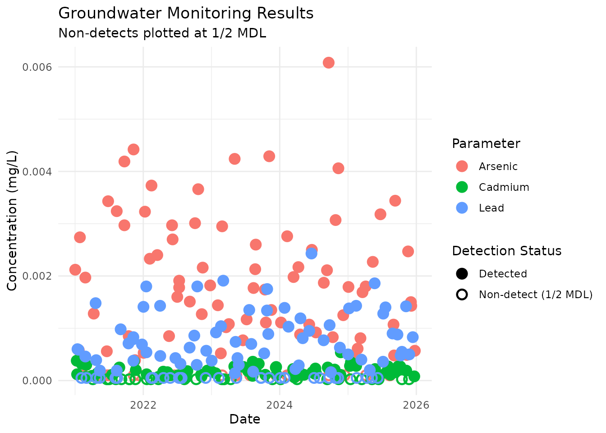
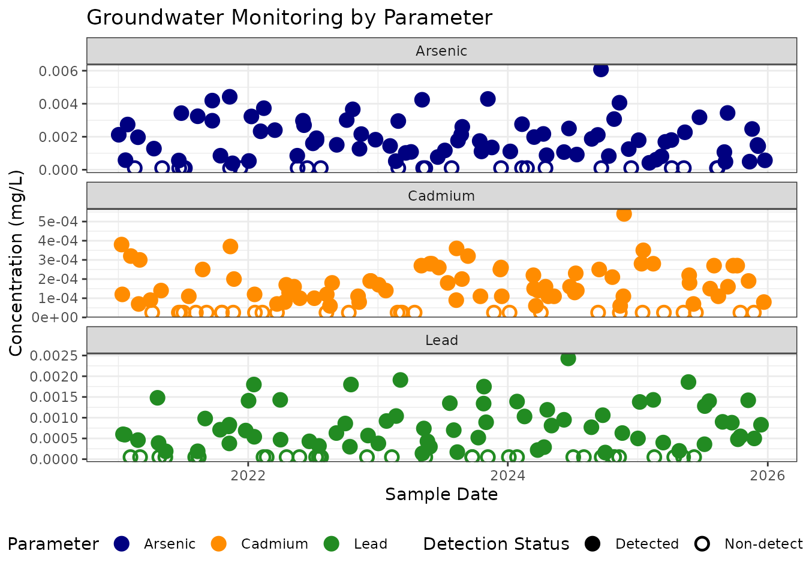

# Plotting Left-Censored Data

## Introduction to Left-Censored Data

In environmental and laboratory data, analytical results are frequently
“left-censored.” This occurs when a target compound is not detected
above the laboratory’s Method Detection Limit (MDL). These non-detects
(often reported as “ND” or flagged with a “U” qualifier) pose a
visualization challenge.

A common standard is to plot non-detects at the MDL or at a fraction of
the MDL (e.g., 1/2 MDL) using a distinct symbology.

The [ggsuppress](https://peernisse.github.io/ggsuppress/) package can
handle this row-by-row dynamically. Let’s look at the built-in
`groundwater` dataset to see how.

``` r

library(ggsuppress)
library(ggplot2)

# View the structure of the data
head(groundwater[10:20,])
#>         Sample_ID Location_ID Sample_Date Parameter  Result Numeric_Result
#> 10 GW-2021Q1-MW-4        MW-4  2021-03-02   Cadmium  0.0003        0.00030
#> 11 GW-2021Q1-MW-4        MW-4  2021-01-27   Arsenic 0.00274        0.00274
#> 12 GW-2021Q1-MW-4        MW-4  2021-01-14      Lead  0.0006        0.00060
#> 13 GW-2021Q1-MW-5        MW-5  2021-02-27   Cadmium   7e-05        0.00007
#> 14 GW-2021Q1-MW-5        MW-5  2021-02-16   Arsenic      ND             NA
#> 15 GW-2021Q1-MW-5        MW-5  2021-02-04      Lead      ND             NA
#>    Units Qualifier   MDL    RL    Method
#> 10  mg/L              NA    NA EPA 200.8
#> 11  mg/L              NA    NA EPA 200.8
#> 12  mg/L              NA    NA EPA 200.8
#> 13  mg/L         J 5e-05 2e-04 EPA 200.8
#> 14  mg/L         U 2e-04 1e-03 EPA 200.8
#> 15  mg/L         U 1e-04 5e-04 EPA 200.8
```

## Data Preparation Requirements

Notice that our groundwater dataset contains a character `Result` column
(which includes “ND” strings) and a `Numeric_Result` column.

**Important:** [ggsuppress](https://peernisse.github.io/ggsuppress/)
requires a numeric y aesthetic. It is the user’s responsibility to
coerce character results into numeric columns prior to plotting. In our
Numeric_Result column, “ND” strings have been converted to NA.

## Plotting Non-Detects Dynamically

To plot these non-detects at 1/2 their specific MDL, we map the MDL
column to the `threshold` and `proxy` aesthetics directly inside the
[`geom_point_suppressed()`](https://peernisse.github.io/ggsuppress/reference/geom_suppress.md)
function.

We also must set `suppress_na = TRUE` so the engine knows to catch those
NA values and apply the proxy math to them.

``` r

ggplot(groundwater, aes(x = Sample_Date, y = Numeric_Result, color = Parameter)) +
  
  geom_point_suppressed(
    # Dynamically apply the MDL for each specific row
    aes(threshold = MDL, proxy = MDL / 2), 
    suppress_na = TRUE, 
    size = 3, 
    stroke = 1.2
  ) +
  # Adjust legend labels for detection status
  scale_shape_suppress(
    name = 'Detection Status',
    labels = c(`FALSE` = "Detected", `TRUE` = "Non-detect (1/2 MDL)")
  ) +
  theme_minimal() +
  labs(
    title = "Groundwater Monitoring Results",
    subtitle = "Non-detects plotted at 1/2 MDL",
    x = "Date",
    y = "Concentration (mg/L)"
  )
```



## Handling Multiple Parameters

Because different chemicals have vastly different scales and MDLs, it is
usually best practice to facet this data. Notice how
[ggsuppress](https://peernisse.github.io/ggsuppress/) handles the
dynamic MDLs across the different facets, and safely ignores rows where
a valid detect was measured but the MDL column was left blank (NA).

``` r

ggplot(groundwater, aes(x = Sample_Date, y = Numeric_Result, color = Parameter)) +
  
  geom_point_suppressed(
    aes(threshold = MDL, proxy = MDL / 2), 
    suppress_na = TRUE, 
    size = 3, 
    stroke = 1.2
  ) +
  
  # Standard scale styling
  scale_color_manual(
    values = c("Arsenic" = "navy", "Cadmium" = "darkorange", "Lead" = "forestgreen")
  ) +
  # Adjust legend labels for detection status
  scale_shape_suppress(
    name = 'Detection Status',
    labels = c(`FALSE` = "Detected", `TRUE` = "Non-detect (1/2 MDL)")
  )  +
  
  # Facet by parameter, allowing the y-axis scales to adjust freely
  facet_wrap(~Parameter, scales = "free_y", ncol = 1) +
  
  theme_bw() +
  theme(legend.position = "bottom") +
  labs(
    title = "Groundwater Monitoring by Parameter",
    x = "Sample Date",
    y = "Concentration (mg/L)"
  )
```


