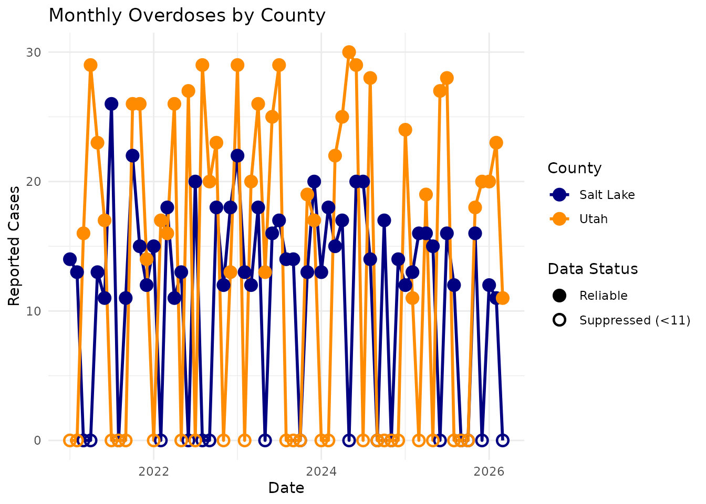
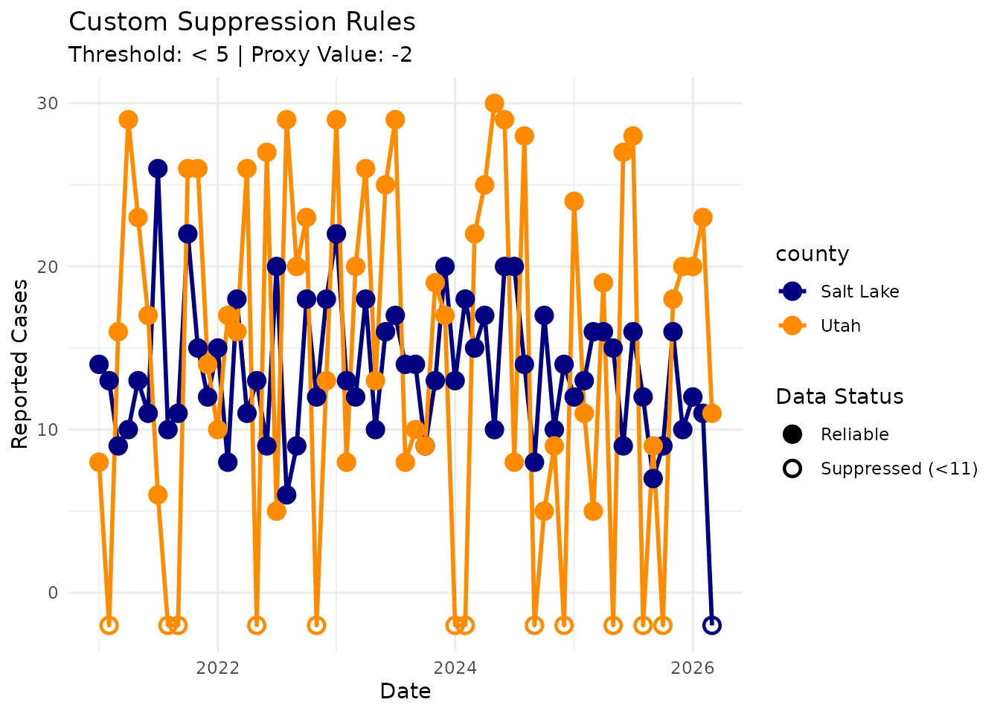
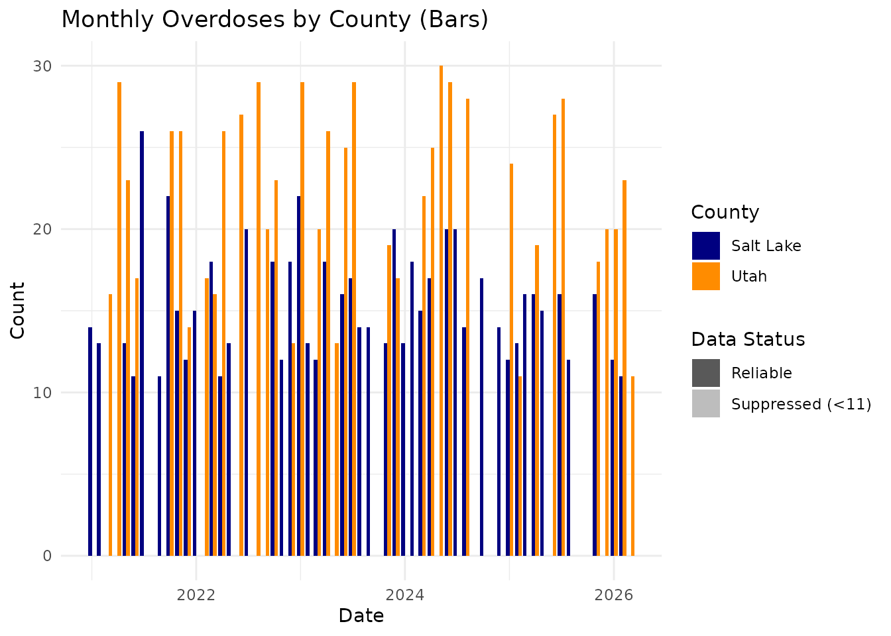

# Small Number Suppression

## Introduction

In public health informatics, it is often necessary to employ
small-number suppression to protect patient privacy and prevent the
misinterpretation of unstable rates. A common health data reporting
threshold may suppress case counts less than 11, for example.

The [ggsuppress](https://peernisse.github.io/ggsuppress/) package
provides custom `ggplot2` geometries to automatically apply these
suppression rules, plot the suppressed data at a proxy value (like 0),
and uniquely symbolize the suppressed points.

Let’s load the necessary packages and explore the built-in `overdoses`
dataset.

``` r

library(ggsuppress)
library(ggplot2)

# The overdoses dataset contains monthly counts for Salt Lake and Utah counties
head(overdoses)
#> # A tibble: 6 × 3
#>   county    month_date count
#>   <chr>     <date>     <int>
#> 1 Salt Lake 2021-01-01    14
#> 2 Salt Lake 2021-02-01    13
#> 3 Salt Lake 2021-03-01     9
#> 4 Salt Lake 2021-04-01    10
#> 5 Salt Lake 2021-05-01    13
#> 6 Salt Lake 2021-06-01    11
```

## Basic Time-Series Plot

To plot this data with automatic suppression, we simply swap out our
standard ggplot2 geometries for their
[ggsuppress](https://peernisse.github.io/ggsuppress/) equivalents:
[`geom_line_suppressed()`](https://peernisse.github.io/ggsuppress/reference/geom_suppress.md)
and
[`geom_point_suppressed()`](https://peernisse.github.io/ggsuppress/reference/geom_suppress.md).

We will also use
[`scale_shape_suppress()`](https://peernisse.github.io/ggsuppress/reference/scale_suppress.md)
to automatically generate hollow points for any values that fell below
our threshold (11).

``` r

ggplot(overdoses, aes(x = month_date, y = count, color = county)) +
  # Draw the lines - ggplot will automatically group them by county
  geom_line_suppressed(linewidth = 1) +
  
  # Draw the points - they will automatically change shape based on suppression
  geom_point_suppressed(size = 3, stroke = 1.2) +
  
  # Standard color mapping
  scale_color_manual(
    name = "County",
    values = c("Salt Lake" = "navy", "Utah" = "darkorange")
  ) +
  
  # Custom ggsuppress scale for hollow/solid shapes
  scale_shape_suppress() +
  
  theme_minimal() +
  labs(
    title = "Monthly Overdoses by County", 
    x = "Date", 
    y = "Reported Cases"
  )
```



## Customizing the Threshold and Proxy Value

What if you are producing a report that requires a different suppression
rule, such as \< 5? Or perhaps you want to plot the suppressed values
below the x-axis (e.g., -2) so they don’t overlap with true zero counts?

You can easily adjust the `threshold` and `proxy_value` parameters
inside the geom functions.

``` r

ggplot(overdoses, aes(x = month_date, y = count, color = county)) +
  
  geom_line_suppressed(
    threshold = 5, 
    proxy_value = -2, 
    linewidth = 1
  ) +
  
  geom_point_suppressed(
    threshold = 5, 
    proxy_value = -2, 
    size = 3, 
    stroke = 1.2
  ) +
  
  scale_color_manual(values = c("Salt Lake" = "navy", "Utah" = "darkorange")) +
  scale_shape_suppress() +
  theme_minimal() +
  labs(
    title = "Custom Suppression Rules",
    subtitle = "Threshold: < 5 | Proxy Value: -2",
    x = "Date", 
    y = "Reported Cases"
  )
```



## Bar Charts and Transparency

For bar charts, changing the shape isn’t an option. Instead,
geom_col_suppressed() automatically maps the suppression flag to the
alpha (transparency) aesthetic. We pair this with scale_alpha_suppress()
to make the suppressed bars semi-transparent.

``` r

ggplot(overdoses, aes(x = month_date, y = count, fill = county)) +
  
  # position = "dodge" places the county bars side-by-side
  geom_col_suppressed(position = "dodge") + 
  
  scale_fill_manual(
    name = "County",
    values = c("Salt Lake" = "navy", "Utah" = "darkorange")
  ) +
  
  # Custom ggsuppress scale for opaque/transparent bars
  scale_alpha_suppress() +
  
  theme_minimal() +
  labs(
    title = "Monthly Overdoses by County (Bars)", 
    x = "Date", 
    y = "Count"
  )
```


